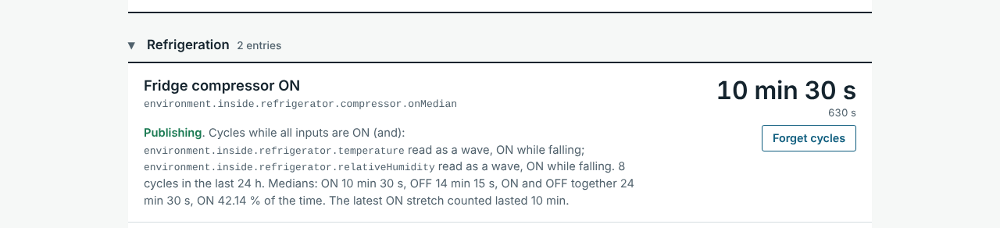
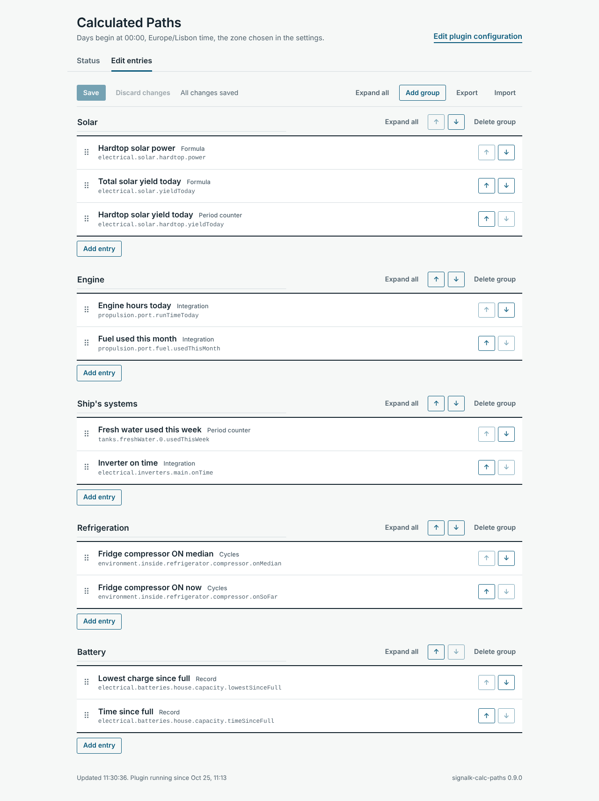
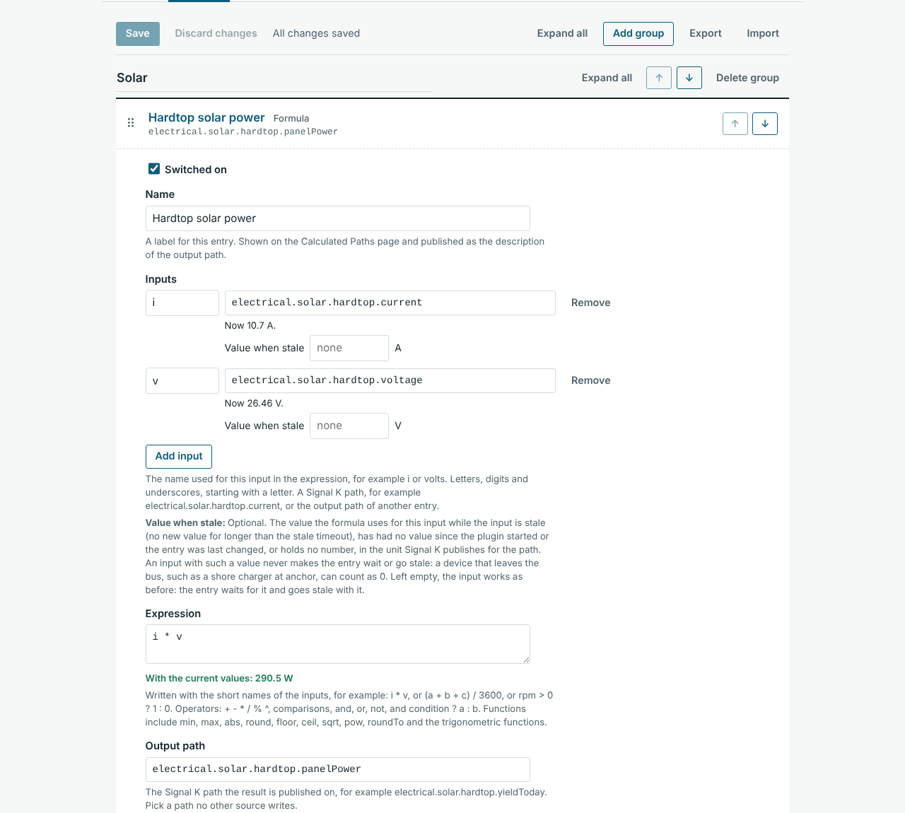
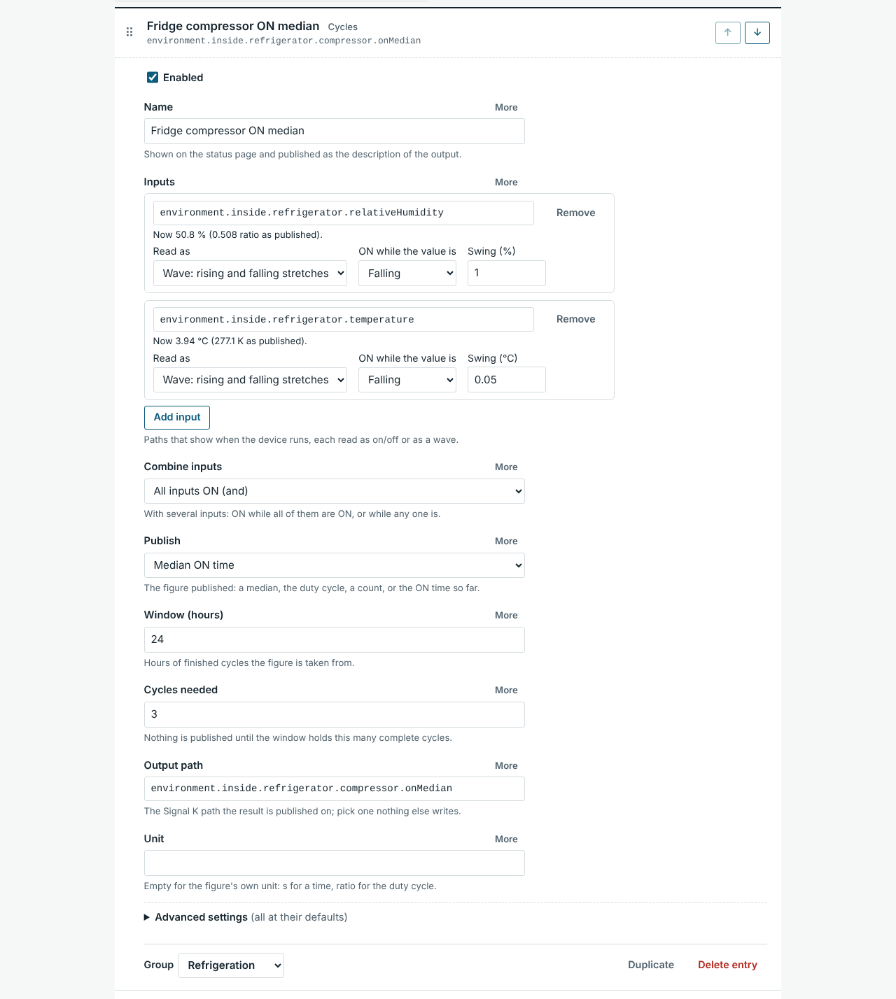
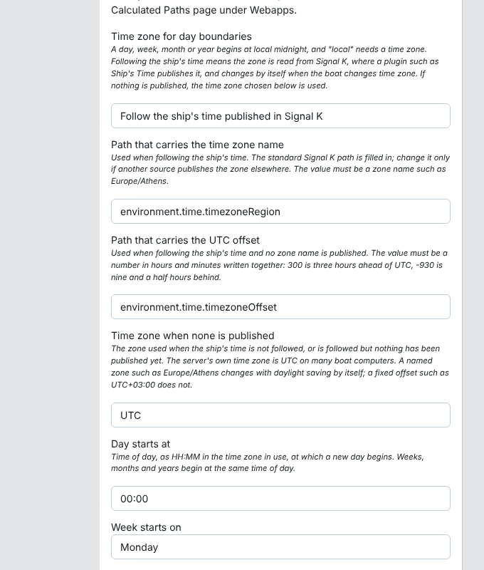

# Signal K Calculated Paths


This plugin calculates new Signal K paths from existing ones and publishes them like any other data. It offers four kinds of calculation: a formula over live values, a counter that reports how much a running total has changed since the start of a day, week, month or year, an integration that adds up a rate over time, and a cycle finder that reports how long a cycling device such as a fridge compressor runs and rests. It targets the Signal K Node server and is meant for boats whose instruments report a raw figure (a current and a voltage, a lifetime energy total, an engine speed) where a derived figure is wanted (power, energy today, engine hours today).

## Project Status

New and actively maintained. The first public release was 0.1.0, in October 2026. The calculations are covered by automated tests and were checked against recorded data from a boat, and the plugin has run inside Signal K server 2.33.0 and 2.34.0; CI tests it against the latest server release and 2.34.0. Wider field use is still to come. See [CHANGELOG.md](CHANGELOG.md) for release history and [Issues](https://github.com/Peter-Petrik/signalk-calc-paths/issues) for planned work.

The plugin publishes calculated values into Signal K paths. It is not an automation tool and does not replace Node-RED: it switches nothing and raises no notifications. A rules or automation plugin can act on the values it publishes, for example to warn when a freezer's compressor cycles have grown long enough to call for a defrost.

## Features

1. **Formulas**: An expression over any number of live paths and constants, for example `i * v` or `(a + b + c) / 3600`. Arithmetic, comparisons, conditions and common mathematical functions are available. Expressions are parsed by a library and never passed to JavaScript's `eval`. An input can be given a value when stale (v0.5.0+), used while the input is stale or has no value, so that a device that leaves the bus, such as a shore charger at anchor, counts as `0` instead of stopping the formula.
2. **Period Counters**: The change in a running total since the start of the day, week, month or year, or since a manual reset. Counting increases suits lifetime energy and engine run time; counting decreases turns a falling tank level into consumption.
3. **Integrations**: A rate added up over time (power into energy, flow into volume), or the time an input spends above a threshold (engine running time, time a switch is on).
4. **Cycles (v0.4.0+)**: The ON and OFF stretches of a device that cycles, found from a switch, from a value against a threshold, or from a value that rises and falls with the device, such as the temperature or humidity inside a fridge. Two or more inputs can be combined, ON while all of them are ON or while any of them is. The median ON time, median OFF time, median cycle, duty cycle, last ON time or number of cycles over a window such as 24 hours is published, or the ON time of the stretch under way (v0.7.0+), which shows a compressor that does not stop.
5. **Selectable Resets**: Each total resets at the start of a day, week, month or year, with a configurable start of day, or in step with another path, so that a calculated daily total can follow a device that keeps its own day. At each period boundary the finished total is published once, stamped just before the boundary, and kept in the reset record (v0.7.0+).
6. **Ship's Time Zone (v0.2.0+)**: Days begin at local midnight in the time zone the vessel keeps. The zone is read from Signal K, where a plugin such as Ship's Time publishes it, and changes by itself when the boat changes time zone. A zone chosen in the settings is used when nothing is published.
7. **Chaining**: An entry can read the output of another entry. A formula can feed an integration, and a counter can feed a formula. Entries are calculated in dependency order, each once per incoming update.
8. **Stale Input Handling**: Each entry stops publishing, or keeps publishing its last result, when an input goes quiet for longer than its stale timeout. The choice is per entry. An entry that stops publishing, for any reason, sends null once on its output path (v0.6.0+), so that the server does not go on serving its last result as if it were current.
9. **State Persistence**: Totals survive server restarts. The state file is replaced whole at each save, through a temporary file, and holds no history.
10. **Unit Metadata**: Each output announces its unit and name, so instrument displays can label it. A unit or name taken out of an entry is cleared on the server too (v0.7.0+).
11. **Entry Editor (v0.3.0+)**: Entries are created and changed on the plugin's page under **Webapps**, with suggestions from the server's live paths, the current value and unit of each path, a live preview of a formula's result, and a note of which entries read each other's results. Saving restarts only the entries that changed; the others keep counting without interruption.
12. **Groups (v0.3.0+)**: Entries can be sorted into groups with names of the user's choosing, and ordered within them. The status page shows a heading per group, and each group can be collapsed. **Expand all** and **Collapse all** act on every entry in the editor, on one group's entries, or on every group of the status page (v0.4.2+).
13. **Status Page**: A page under **Webapps** lists every entry with its current value and its state and, for counters, integrations and cycles entries, a reset button. Paths named in its sentences are set in a code font.
14. **Reset Record (v0.2.1+)**: Each total records when and why it was last cleared: a new period, the followed path falling from one value to another, a request, or a change of time zone. The status page shows the record, together with the last change of the followed time zone and the time the plugin started.
15. **Clock Safety**: Sums are measured on a monotonic clock, and period resets pause while the system clock is recognisably unset, so a computer that boots at 1970 does not reset its totals or count the correction as elapsed time. Once the clock is set, what was counted since the plugin started stays in the new period when the start came after the boundary (v0.7.0+).

## Prerequisites

1. **Signal K Server**: Developed on Signal K server 2.33.0 and 2.34.0; CI tests the latest release and 2.34.0. The status page and the editor need Safari 15 or later, or a current Chrome, Edge or Firefox.
2. **Node.js**: Version 22 or later.
3. **Input Paths**: The paths to calculate from must already be present in Signal K. **Data > Browser** shows them with their units.
4. **Ship's Time (optional)**: A plugin that publishes the vessel's time zone, such as [Ship's Time](https://www.npmjs.com/package/@meri-imperiumi/signalk-ships-time), lets day boundaries follow the boat. Without one, a time zone is chosen in the settings.

## Quick Start Guide

1. Open the Signal K admin UI, navigate to **Apps & Plugins > Store** and install `signalk-calc-paths`.
2. Restart the server when prompted.
3. Go to **Apps & Plugins > Configuration > Calculated Paths**, enable the plugin and check the time zone. With a ship's time plugin installed nothing needs to be set. Otherwise pick a zone under **Time zone when none is published** if the server does not run on local time.
4. Click **Submit**.
5. Open **Webapps > Calculated Paths** and the **Edit entries** tab.
6. Click **Add entry**, choose a formula, a period counter, an integration or a cycles entry, and fill in its paths and unit.
7. Click **Save**.
8. The **Status** tab shows each entry's value and state, and the time zone in use. Check the new path under **Data > Browser**.

### Updating

1. Update `signalk-calc-paths` under **Apps & Plugins > Store** and restart the server when prompted.
2. Entries, groups and saved totals are kept. An installation older than 0.3.0 is moved over by itself; what that does, and how to go back to an earlier version, is in [Upgrading From Earlier Versions](https://github.com/Peter-Petrik/signalk-calc-paths/blob/master/docs/upgrading.md). Read [CHANGELOG.md](CHANGELOG.md) for what changed; an entry in it under **Changed** can alter what readers of an output path see, as the null sent by an entry that stops publishing did in 0.6.0.

### Uninstalling

1. Remove the plugin under **Apps & Plugins > Store** and restart the server. Its output paths receive no further values.
2. The entries, the totals and the settings stay on disk: `~/.signalk/plugin-config-data/signalk-calc-paths/` (`entries.json`, `state.json`) and `~/.signalk/plugin-config-data/signalk-calc-paths.json`. Delete them to remove everything, or keep them for a later reinstall, which takes them up again. Use **Export** first to keep the entries in a file.
3. A history database keeps what it stored from the outputs.

## Configuration

Configuration has two parts:

1. **Settings** that apply to every entry (the time zone, the start of the day and week, the repeat interval) are entered under **Apps & Plugins > Configuration > Calculated Paths**. The **Edit plugin configuration** link at the top of the plugin's page opens them.
2. **Entries** are created and changed under **Webapps > Calculated Paths > Edit entries**. See [Editing Entries](#editing-entries). An installation that kept its entries in the settings, as 0.2.x did, moves them over by itself; see [Upgrading From Earlier Versions](https://github.com/Peter-Petrik/signalk-calc-paths/blob/master/docs/upgrading.md).

The tables below list the fields of each entry in the order the editor shows them.

### General Settings

| Setting | Default | Meaning |
| :--- | :--- | :--- |
| Time zone for day boundaries | Follow the ship's time published in Signal K | Follow the ship's time, or always use the time zone chosen below. See [Time Zones and Day Boundaries](#time-zones-and-day-boundaries). |
| Path that carries the time zone name | `environment.time.timezoneRegion` | Read when following the ship's time. Expected to hold a zone name such as `Europe/Athens`. |
| Path that carries the UTC offset | `environment.time.timezoneOffset` | Read when following the ship's time and no zone name is published. Expected to hold a number such as `300`. |
| Time zone when none is published | The server's own time zone | A list with the server's zone, UTC, the fixed offsets from UTC-12:00 to UTC+14:00, and the named zones. Many boat computers run on UTC, in which case the server's zone is not local time. |
| Day starts at | `00:00` | Time of day, as `HH:MM` in the time zone in use, at which a new day begins. Weeks, months and years begin at the same time of day. |
| Week starts on | Monday | Monday, Sunday or Saturday. |
| Repeat unchanged values every | 10 s | A result is published when it changes, at most once a second. An unchanged result is sent again at this interval. `0` publishes changes only. |

### Fields Shared by All Entries

Every entry begins with **Switched on** and **Name** and ends with **Stale timeout** and **When an input is stale**. **Output path** and **Unit** sit between, where the table of each type shows them.

| Field | Default | Meaning |
| :--- | :--- | :--- |
| Switched on | on | An entry that is switched off publishes nothing more and keeps its saved total; if it had published since the plugin started, it sends null once on its output path. It may be saved unfinished. |
| Name | empty | Label shown on the status page and published as the output's description. |
| Output path | none | The Signal K path the result is published on. It needs at least two segments and should not be written by another source: the editor warns when it is, but does not prevent it (see item 14 under [Limitations and Assumptions](#limitations-and-assumptions)). It cannot be the path the time zone is read from. |
| Unit | empty | Unit published with the output. Signal K uses SI units such as `W`, `J`, `V`, `A`, `s`, `m3`, `K`, `Pa` and `ratio`. The editor warns about a unit Signal K does not define, such as `kWh` (v0.7.0+); such a unit can be saved and is published as given. |
| Stale timeout | 60 s | An input with no new value for this long is stale. `0` means the input is sent only when it changes and never goes stale. |
| When an input is stale | Stop publishing | Stop publishing until the input returns, or keep publishing the last result. An entry that stops publishing sends null once on its output path (v0.6.0+); see [Stale Inputs](#stale-inputs). |

### Formulas

| Field | Default | Meaning |
| :--- | :--- | :--- |
| Switched on, Name | | See [Fields Shared by All Entries](#fields-shared-by-all-entries). |
| Inputs | none | A list of inputs, each with a **Short name** and a **Path**. A short name is made of letters, digits and underscores, does not start with a digit or with two underscores, and is not the name of a function or constant such as `max`, `E`, `PI`, `true` or `false`. Paths cannot be written directly in an expression because they contain dots and dashes. |
| Value when stale | empty | Per input, under its path (v0.5.0+). The value the formula uses for that input while the input is stale, has had no value since the plugin started or the entry was last changed, or holds `null` or something that is not a number. It is given in the unit Signal K publishes for the path, as the formula calculates with that. An input with such a value never makes the entry wait or go stale. Left empty, the entry waits for the input and goes stale with it. See [Stale Inputs](#stale-inputs). |
| Expression | none | The calculation, written with the short names. |
| Output path, Unit, Stale timeout, When an input is stale | | See [Fields Shared by All Entries](#fields-shared-by-all-entries). |

Operators: `+`, `-`, `*`, `/`, `%`, `^`, the comparisons `==`, `!=`, `<`, `<=`, `>`, `>=`, the logical `and`, `or`, `not`, and the condition `test ? a : b`. A comparison used as the whole expression publishes `1` or `0`. The constants `PI` and `E` are available.

Functions: `abs`, `acos`, `acosh`, `asin`, `asinh`, `atan`, `atan2`, `atanh`, `cbrt`, `ceil`, `cos`, `cosh`, `exp`, `expm1`, `floor`, `hypot`, `if`, `lg`, `ln`, `log`, `log10`, `log1p`, `log2`, `max`, `min`, `pow`, `pyt`, `round`, `roundTo`, `sign`, `sin`, `sinh`, `sqrt`, `tan`, `tanh`, `trunc`.

Assignment, function definitions, arrays, string concatenation and property access are switched off. A result that is not a finite number, such as a division by zero, is not published; a formula that had published sends null once instead (see [Stale Inputs](#stale-inputs)). The constants `true` and `false` stand for 1 and 0.

### Period Counters

| Field | Default | Meaning |
| :--- | :--- | :--- |
| Switched on, Name | | See [Fields Shared by All Entries](#fields-shared-by-all-entries). |
| Input path | none | The path of the running total, or the output path of another entry. |
| Count | Increases only | Increases only, decreases only, or net change (signed). |
| When the input moves the other way | Carry on | Carry on counting from the new value, or wait until the previous level is passed again. Applies to the two one-way settings. With "Carry on", a single value the other way that the next value undoes is taken as a glitch and not counted (v0.7.0+); see [Counter Direction](#counter-direction). |
| Smallest change to count | 0 | Changes smaller than this are ignored until they add up to at least this much. Entered in the unit shown beside the field; see [Units in the Editor](#units-in-the-editor). |
| Output path, Unit | | See [Fields Shared by All Entries](#fields-shared-by-all-entries). The unit is normally that of the input. |
| Resets | Every day | Every day, week, month or year; when another path resets; or only by hand. Changing it clears the total. |
| Path to follow for resets | empty | Used with "When another path resets". The total is cleared when the value on this path falls to below half of the value before, or to zero (v0.7.0+); see [Period Boundaries](#period-boundaries). |
| Stale timeout, When an input is stale | | See [Fields Shared by All Entries](#fields-shared-by-all-entries). |

### Integrations

| Field | Default | Meaning |
| :--- | :--- | :--- |
| Switched on, Name | | See [Fields Shared by All Entries](#fields-shared-by-all-entries). |
| Input path | none | The path to add up, or the output path of another entry. |
| Add up | The value multiplied by time | Value multiplied by time gives the input's unit times seconds (`W` becomes `J`, `m3/s` becomes `m3`). The alternative adds up the time the value is above the threshold, in seconds. |
| Threshold | 0 | Used when adding up time. Time counts while the input is greater than this. Entered in the unit shown beside the field; see [Units in the Editor](#units-in-the-editor). |
| Output path, Unit | | See [Fields Shared by All Entries](#fields-shared-by-all-entries). The unit is `J` for power added up over time, `m3` for a flow in `m3/s`, `s` for time. |
| Resets, Path to follow for resets | Every day, empty | As for period counters. |
| When values stop for longer than the stale timeout | Leave the gap out | Leave the gap out of the total, or bridge it with the last value. |
| Stale timeout, When an input is stale | | See [Fields Shared by All Entries](#fields-shared-by-all-entries). |

### Cycles

A Cycles entry finds the ON and OFF stretches of a device that cycles and publishes one figure about them. See [How Cycles Are Found](#how-cycles-are-found) for the details, and [Fridge and Freezer Compressors](#fridge-and-freezer-compressors) for a worked example.

| Field | Default | Meaning |
| :--- | :--- | :--- |
| Switched on, Name | | See [Fields Shared by All Entries](#fields-shared-by-all-entries). |
| Inputs | none | One or more paths that show when the device runs. Each is read as on/off or as a wave, as set in the next four fields, which each input has with its path. |
| Read as | On/off | **On/off, against a threshold**: the input is ON while its value is greater than **ON above**. A switch sends true or false, which count as 1 and 0. **Wave**: the input rises and falls with the device without saying which state it is in; every stretch between two turning points is one ON or one OFF stretch. |
| ON above | 0 | On/off inputs. In the unit shown beside it, for example `1` A for a current or `5` °C for a temperature. |
| ON while the value is | Falling | Wave inputs. Falling for the temperature or humidity in a fridge or freezer, which drop while the compressor runs; rising for something a heater warms. |
| Swing | none, required | Wave inputs. How far the value must turn back before a turning point counts, in the unit shown beside it. See [Choosing the Swing](#choosing-the-swing). |
| Combine inputs | All inputs ON (and) | With more than one input: ON while every input is ON, or while at least one is. See [Combining Inputs](#combining-inputs). |
| Publish | Median ON time | Median ON time, median OFF time, median cycle (an ON stretch plus the OFF stretch after it), duty cycle (the share of time ON), last ON time, number of cycles, or ON time so far (v0.7.0+): the length of the ON stretch under way, 0 while OFF, published every second while ON and counted past the longest stretch. Times are published in seconds, the duty cycle as a ratio from 0 to 1, the number of cycles as a plain number. |
| Window | 24 hours | The figure is taken from the stretches that ended within this many hours. Must be above 0. Not used for the ON time so far, and then not shown. |
| Cycles needed | 3 | Nothing is published until the window holds this many complete ON stretches. Not used for the number of cycles, which is always published, nor for the ON time so far; for both it is not shown. |
| Output path | none | See [Fields Shared by All Entries](#fields-shared-by-all-entries). |
| Unit | empty | Left empty, the unit of the figure is published: `s` for times, `ratio` for the duty cycle. |
| Smoothing | 150 s | Wave inputs. The span the 30-second step means are averaged over before turning points are looked for. `30` switches this second averaging off. At most 1800 s. |
| Shortest stretch | 120 s | A change of the combined state counts only once it has held this long. |
| Longest stretch | 7200 s | Stretches longer than this are left out of the figures. A wave that has not turned for this long is left out of the combination, except by an entry that publishes the ON time so far when the wave went flat while ON. Must be longer than the shortest stretch. |
| Stale timeout | 180 s | An input with no new value for this long has a gap, and the stretch under way is not measured. The entry itself counts as stale only while every input is silent. Two or three times the interval at which the slowest input reports; `0` for an input sent only when it changes, such as a switch state. Cycles entries default to 180 s rather than 60 s, so that a sensor reporting about once a minute is not cut by one late report. |
| When an input is stale | Stop publishing | See [Fields Shared by All Entries](#fields-shared-by-all-entries). |

#### Combining Inputs

The inputs are combined at each moment, as the conditions of a rule are. "All" is ON only while every input says ON, so a cycle that only one input shows, such as a fridge door left open, is not counted. "Any" is ON while at least one input says ON.

Inputs that respond with a delay change the lengths read. In a fridge the humidity follows the compressor a little later than the temperature does. Take a compressor that runs from 10:00 to 10:10:

| Input | ON while falling |
| :--- | :--- |
| Temperature | 10:00 to 10:10 |
| Humidity | 10:02 to 10:12 |
| **All inputs ON (and)** | 10:02 to 10:10, read as **8 minutes** |
| **Any input ON (or)** | 10:00 to 10:12, read as **12 minutes** |

Neither is the compressor's own 10 minutes, and the difference is the same from one cycle to the next. A combined figure therefore shows a trend as well as a single input does, but an alert limit must be chosen on the combined figure, not taken from a measurement of one input or of the compressor itself.

An input with nothing to say is left out, and the others decide alone: an input with no value yet or with a gap in its data, and a wave that has not turned for longer than the longest stretch. The last covers a sensor too slow or too well insulated to show the cycles at all. A stretch during which an input drops out or comes back is not measured, because part of it was timed by different inputs.

#### Choosing the Swing

The swing is entered in the unit the editor shows beside it, and kept in the unit Signal K publishes (see [Units in the Editor](#units-in-the-editor)):

| Input | Entered as | Kept as |
| :--- | :--- | :--- |
| Temperature | `0.05` °C | `0.05` K |
| Relative humidity | `1` % | `0.01` (ratio) |
| Current | `0.5` A | `0.5` A |

Set it above the noise of the sensor and below the rise and fall of one cycle. Too small, and noise cuts stretches into pieces; too large, and cycles are missed. A third of the typical rise and fall of one cycle is a reasonable start. A history of the input in a database such as InfluxDB, viewed over an hour, shows both. Then compare the number of cycles on the status page with the graph.

## Editing Entries

Entries are edited on the plugin's page: **Webapps > Calculated Paths**, tab **Edit entries** (v0.3.0+). The tab appears for users who may change data (read/write or admin access); a read-only login sees the status only.

### Building an Entry

1. **Add entry**, at the foot of a group or of the entries outside any group, offers the four kinds, each explained in one line. **Add group** brings the new group into view with its name selected, ready to be typed over.
2. Path fields suggest the paths the server knows on the vessel, including the outputs of other entries. Under each path field the current value and unit are shown, or a note that the path holds nothing, or holds something that cannot be calculated with, such as a position.
3. A formula shows its result with the current values a moment after typing stops, or says why there is none yet. Each input has a **Value when stale** box, with the input's published unit beside it (v0.5.0+); the result shown uses those values for inputs that are stale or have no value, and names them.
4. An entry that reads another entry's result, or whose result another entry reads, says so, so a chain of entries can be followed.
5. Fields that apply only to some settings, such as the threshold of an integration that adds up time, appear only when they apply.
6. A unit that Signal K does not define, such as `kWh`, is pointed out under the **Unit** field (v0.7.0+). It does not stop a save.
7. On a narrow screen each field's explanation is collapsed behind a **Help** button beside its title, and **Expand all**, **Add group**, **Export** and **Import** are collapsed behind **More**, so the bar at the top stays on one line.
8. Removing an input moves the focus to the input now in its place. Escape, pressed while the focus is on a step that asks for confirmation (**Delete entry**, **Delete group**, **Discard changes**, the question before a save that costs a total, and **Reset to zero** or **Forget cycles** on the status page), cancels it.

### Units in the Editor

A setting given in the unit of an input path is shown and entered in the unit the Signal K rules editor uses for that path, and kept in the unit Signal K publishes (v0.4.1+):

| Unit in Signal K | Shown and entered as | Example |
| :--- | :--- | :--- |
| `K` (temperature) | °C | A threshold of `5` °C is kept as `278.15`; a swing or smallest change of `0.05` °C is kept as `0.05`, since a difference has no offset. |
| `ratio` (humidity, state of charge) | % | `1` % is kept as `0.01`. |
| `Pa` (pressure) | hPa | `2` hPa is kept as `200`. |
| Any other unit | as published | `0.5` A is kept as `0.5`. |

This applies to the threshold and swing of a cycles input, the threshold of an integration that adds up time, and the smallest change of a period counter. The unit shown follows the input path, and appears beside the field's title as soon as the path is known; for a path that has no value or unit yet, the field says "in the input's unit". A number typed in such a field means what it says in the unit shown once it is known: `1` typed before a humidity path is chosen is 1 %. The hint under a path field shows the current value in the same unit, with the value as published beside it; under a formula's inputs the value as published leads, since a formula calculates with it. The entries file, an export and the HTTP interface hold the published unit, so entries saved by 0.4.0 read unchanged. A formula input's value when stale is entered in the published unit, which is shown beside it, since the formula calculates with published values.

### Groups and Order

1. **Add group** creates a group. Its name is edited in place, and the arrow buttons beside it move it up or down.
2. **Expand all** in the editing bar expands every entry, and **Expand all** beside a group's name expands that group's entries; while there are groups, the block of entries outside any group has one too. Each button turns into **Collapse all** once every entry it acts on is expanded.
3. An entry is moved into a group with its **Group** selector, or by dragging it by its handle onto another entry or onto a group's list. Dragging needs a mouse; on a touch screen the arrow buttons move an entry within its group.
4. **Delete group** keeps the group's entries: they join the entries outside any group.
5. On the status page the entries outside any group come first, without a heading, followed by the groups in their order. A set with no groups reads as one plain list. A group's heading collapses it; each browser remembers which groups are collapsed. With two or more groups, a button above them expands every group while any is collapsed, and collapses them all once all are expanded; it is named after what it will do, **Expand all** or **Collapse all**. A browser that keeps no site data forgets collapsed groups when the page is left.
6. Groups and order change only what is shown. They change no calculation, path or total.

### Saving

1. Nothing reaches the server until **Save**. The page warns before it is left with unsaved changes, and **Discard changes** returns to the set last saved, with every entry closed. Changes count as unsaved only while the set differs from the saved one, so an edit undone by hand leaves nothing to save.
2. The set is checked on the server before anything is saved. An entry that is switched on and cannot run (a missing path, an expression that does not parse, a setting that is not a number, two entries writing one path, an output on the path the time zone is read from, entries that feed each other in a loop) stops the save. A number may be typed with a decimal comma, as `1,5`; a comma followed by exactly three digits, as in `1,500`, could separate thousands and is refused. Every fault is listed at the entry and each field it lies in is marked; a mark clears as soon as the field is changed. An entry that is switched off may be saved unfinished. After a save every entry is closed, except one the server reports a fault in; entries changed while the save was on its way stay as they are.
3. When a save costs a total, the page lists what is lost and asks first: a counter or integration that is deleted, or whose output path, input path, direction, integration mode, threshold (when adding up time) or **Resets** setting changes, and a cycles entry whose finished stretches are forgotten because its inputs, how they are read, how they are combined, its smoothing, its shortest stretch or its stale timeout change. Other changes keep the total. Totals belong to output paths, so the comparison is made by output path: an entry that takes over an output, from an import for instance, continues its total.
4. Saving restarts only the entries whose calculation changed. An entry that differs only in its name, unit or group, and every entry left alone, keeps running as it was, in the middle of whatever it was adding up, also when it reads the result of an entry that restarted. The page reports how many entries kept running and how many started. A restarted integration begins its next stretch at the save: the time since its input's last value, at most one sampling interval, is not added.
5. A started entry is handed the latest value of each path it reads at once, so an entry on a path that is sent rarely, such as a switch state, does not wait for the path to speak again.
6. If the entries were saved elsewhere since the editor read them, for instance from a second browser, the save is refused, and the page offers to reload or to export the changes first. A save must name the version of the entries it was based on; the HTTP interface refuses one that does not.
7. A set of entries is limited to 500 entries, 100 groups, 50 inputs per entry, 500 characters per text field and 1 MB in all. A save or import over these limits is refused.

### Import and Export

**Export** downloads the set shown in the editor, with its groups, as `calculated-paths-entries.json`. **Import** reads such a file and replaces the set shown; nothing is saved until **Save**. A file can serve as a backup or carry a set to another server. Totals belong to output paths, so an imported entry continues a saved total on the same output path where it measures the same thing.

## Time Zones and Day Boundaries

A total that resets "every day" resets at midnight, and midnight depends on the time zone. The same holds for weeks, months and years, which begin at the same time of day. This section explains which time zone the plugin uses and what happens when it changes. Entries that reset when another path resets, or only by hand, are not affected by any of it.

### Which Time Zone Is Used

With **Time zone for day boundaries** set to follow the ship's time, the plugin takes the first of these that is available:

1. **The zone name published in Signal K.** The path `environment.time.timezoneRegion` holds a name such as `Europe/Athens`. A name is preferred because it carries the zone's daylight saving rules.
2. **The UTC offset published in Signal K.** The path `environment.time.timezoneOffset` holds a number such as `300`. Both paths are defined by the Signal K specification as the time zone the vessel keeps. It is used when no name is published. It is also used when it was published after the name and disagrees with it, which happens when a source stops publishing a name and the old one is still held by the server. Which of the two is newer is read from their time stamps. A name and an offset published together are taken as belonging together, and the name is used.
3. **The last zone followed.** It is remembered across restarts, so that a restart does not fall back to the setting while the source has not spoken yet.
4. **The zone chosen under "Time zone when none is published".** The default choice is the server's own time zone.
5. **UTC**, if the server's time zone cannot be read.

With the setting on "Always use the time zone chosen below", only steps 4 and 5 apply and nothing is read from Signal K.

The status page states the zone in use and where it comes from, for example "Days begin at 00:00, Europe/Athens time, the ship's time read from environment.time.timezoneRegion." The plugin's status line in the admin UI includes "Time zone Europe/Athens" while a zone is being followed.

### Setting It Up

**A ship's time plugin is installed.** Nothing needs to be set in this plugin. The [Ship's Time](https://www.npmjs.com/package/@meri-imperiumi/signalk-ships-time) plugin, in its automatic mode, works out the zone from the vessel's position and publishes both standard paths, and they are followed as installed.

Ship's Time itself needs one look. Version 0.1.0 of it is enabled as soon as it is installed and starts in manual mode with an offset of zero, which is UTC. Until it is switched to automatic, or given the right offset, it publishes UTC and this plugin follows that, whatever zone is chosen in the settings here. The status page shows the zone in use, which makes this easy to spot.

**Another source publishes the zone.** Custom code, Node-RED or another plugin can publish the zone on any path. That path is entered under **Path that carries the time zone name** or **Path that carries the UTC offset**, depending on what it holds. Either field accepts either form, and the same path may be entered in both.

**Nothing publishes the zone.** A zone is picked under **Time zone when none is published**. A named zone such as `Europe/Athens` is the better choice where one fits, because it changes with daylight saving by itself. A fixed offset such as "UTC+03:00" never changes: it has to be changed by hand when the clocks change and when the boat moves to another zone.

**Nothing is set at all.** The server's own time zone is used. On a boat computer set to UTC, a day then runs from midnight UTC, which is 02:00 or 03:00 by the clock in the eastern Mediterranean.

### What a Followed Path May Hold

| Value on the path | Read as |
| :--- | :--- |
| `"Europe/Athens"` | The named zone, with its daylight saving rules. |
| `"Pacific/Marquesas"` | The named zone, 9 hours 30 minutes behind UTC. |
| `"europe/athens"` | The same zone in any letter case, written as the server's runtime writes it, so that two spellings are not two zones (v0.6.1+). A different name for the same zone, such as `US/Pacific` for `America/Los_Angeles`, is kept and shown as given. |
| `300` | 3 hours ahead of UTC. The number is hours and minutes written together, as the Signal K specification defines the offset path. |
| `-930` | 9 hours 30 minutes behind UTC. |
| `545` | 5 hours 45 minutes ahead of UTC. |
| `0` | UTC. |
| `"+03:00"`, `"UTC+3"` | 3 hours ahead of UTC, written as text. |
| `180`, `10800` | Refused. `180` would be 1 hour 80 minutes, and `10800` is further from UTC than any clock. An offset given in minutes or seconds is not understood. |
| `3` | 3 minutes ahead of UTC, not 3 hours. An offset given in whole hours is misread; `300` is the form for 3 hours. |
| `null` | No value. On the name path the offset is then used, if one is published; otherwise the last zone followed stays in use. |
| An object, other text | Not used, and reported on the status page. |

A value that cannot be read is never used. It is reported on the status page for as long as the path holds it, also when the other path is fine: an unreadable name means the zone's daylight saving rules are not being followed.

### When the Boat Changes Time Zone

A total belongs to a calendar date. When the time zone changes, the plugin asks one question: has a later date begun? If so, the total is cleared. If not, it carries on. A total is never cleared twice for the same date.

This is the same thing that happens to every clock twice a year at a daylight saving change: one day is an hour short and another an hour long. Going east across midnight starts the new date at the moment of the change; going west back across midnight, the date steps back and the total carries on until the next date begins. Worked examples with the times and what the status page says: [Time Zone Changes, Worked Through](https://github.com/Peter-Petrik/signalk-calc-paths/blob/master/docs/time-zones.md).

### The Zone After a Restart

The last zone followed is saved with the totals. After a restart the plugin starts in that zone and the status page says the zone was "last read" from its path until the source publishes it again. If the source publishes a different zone, for instance because the boat moved while the server was off, the change is handled as described above.

Switching **Time zone for day boundaries** to the fixed setting, or changing either path, discards the remembered zone.

### Seeing When the Zone Changed

The status page states the last change of the followed zone (v0.2.1+): when it happened, and from which zone to which. A change of the path the zone is read from, with the clock time unchanged, is stated as well, because a name carries daylight saving rules and a bare offset does not. The record is saved with the totals. A zone that changes although the vessel has not moved points at the plugin that publishes it; see item 6 under [Limitations and Assumptions](#limitations-and-assumptions).

## How the Calculations Behave

### Period Boundaries

1. The baseline of a period is the last input value seen before the boundary. At the boundary the output publishes the closing total of the period that ended, stamped one millisecond before the boundary, and then `0` (v0.7.0+). A reader that keeps a history, such as a database, thus holds the day's final figure at the end of the day. The closing total is also kept in the reset record, and shown on the status page. It is not published for a boundary that passed while the plugin was stopped, nor while the entry is not publishing; it is recorded all the same. A change of time zone that begins a new date closes the total the same way, dated one millisecond before the change. A clock that ran ahead, passed the boundary early and was set back by less than five minutes passes it again: the second closing total is then the whole period, sent with the same time stamp. A server started with `--override-timestamps` stamps the closing total with the time it arrives instead. An entry that reads the total receives the new period's value, not the closing total; see item 28 under [Limitations and Assumptions](#limitations-and-assumptions).
2. For a period counter, change that arrives with the first value after a boundary belongs to the new period. With an input that reports every few seconds this moves at most a few seconds of change across the boundary. An integration splits the stretch at the boundary; see [Integration Method](#integration-method).
3. Days follow the time zone in use (see [Time Zones and Day Boundaries](#time-zones-and-day-boundaries)), including its daylight saving changes: a day is 23 or 25 hours long on the two change dates. Where a clock change skips the day-start time itself, that day begins later by the length of the skipped stretch; where the day-start time occurs twice, the day begins the first time.
4. With "When another path resets", the boundary settings are not used. The total clears when the followed value falls to below half of the value before, or to zero (v0.7.0+), as a daily total does that another device sets back. A smaller fall, such as rounding noise, is not a reset; the level the next fall is measured from moves down with it, so a total that slips down in small steps and then drops to zero resets once, at the zero. From a value of zero or below, any fall resets. The first value after a start, or after the entry was changed, is compared with the level saved before, and there any fall resets: the device may have begun its new day while the plugin was stopped and climbed above half of the old level since. Such a fall is noticed only if the followed value is still below the last one seen before the stop.

### Restarts

1. Totals, baselines, period starts and the last time zone followed are restored from the state file. Changing an entry's **Resets** setting clears its total, because a total collected under one rule means nothing under another; a period counter keeps its place in its input.
2. A period counter resumes from the last input value it saw. Whatever the source counted while the server was stopped is added when the first new value arrives. If a boundary passed in the meantime, that change lands in the current period and the status page says so.
3. An integration adds nothing for the time the server was stopped.
4. A restored total is the entry's value from the first moment, before any input has arrived. Until the input sends a value the entry is shown as stale, with the text "No value on ... since the plugin started", and its total is published or not as **When an input is stale** says. An entry with a stale timeout of `0` never counts as stale, so its restored total is always published. An engine that is switched off therefore does not make "engine hours today" disappear when the server restarts, provided the entry is set to keep publishing. The total still rolls over at its period boundary while the input stays silent, and the text then says the total has been cleared since.
5. An entry that reads a restored total which is being published receives it at the first pass after the start, so a counter chained on it does not miss a boundary that passed in between.
6. Values the server already holds when the plugin starts are used at once, each judged against the stale timeout by its real age. An integration counts from the start, not from the age of such a value.
7. The server keeps the last value of every source that ever wrote to a path. Only one of them is used at start-up; see [Input Values](#input-values).

### Counter Direction

1. With "Increases only", a fall in the input is not counted. By default counting carries on from the new, lower value, which is the right behaviour for a source counter that restarts from zero. The alternative waits until the input has passed its previous level, which ignores a longer dip in a total that should never go back.
2. With "Decreases only", a rise is not counted. This suits a tank: the level falling is consumption, and a refill is ignored.
3. A glitch (v0.7.0+). With "Carry on", a value that moves the other way is held back until the next value. If that one is back at the earlier level, within the smallest change to count, or beyond it, the held value was a glitch, such as a single `0` from a device that is starting, and counting goes on from the earlier level; otherwise the source has restarted, and counting carries on from the new level as before. A move the other way straight after a confirmed restart is taken at once. The held value is saved with the totals.
4. "Net change" reports the signed difference since the period began. It, and "Wait until the previous level is passed again", are not affected by the glitch rule.

### Integration Method

1. An input with a stale timeout above zero is treated as regularly sampled. Consecutive values are joined by a straight line (the trapezoid rule), and the total grows when each new value arrives.
2. An input with a stale timeout of `0` is treated as a value that holds until the next one arrives. The total grows every second in between. This suits a switch state or any input that is sent only when it changes.
3. A stretch between two values that is longer than the stale timeout is a gap. By default it is left out, so the total undercounts and never invents data. With "bridge" the input is assumed to have stayed at its last value for the whole gap.
4. A stretch that spans a period boundary is split at the boundary (v0.7.0+). The part before it is added to the period that ends, at the last value, since the next one is not known at the boundary, and counted in its closing total; the part after it goes to the new period. The part before the boundary is added only where the stretch is not a gap, or is bridged.

### Input Values

1. Numbers are used as they are. `true` and `false` count as `1` and `0`.
2. `null` means the source has no reading: a formula waits and has no result (if it had published, it sends null once; see [Stale Inputs](#stale-inputs)), and an integration does not join the values on either side of it. A formula input with a value when stale uses that value instead.
3. Text, objects such as a position, and numbers that are not finite are treated the same way as `null`, also by a value when stale.
4. Where several sources publish one path, the plugin receives the source the server's source priority prefers.
5. Values that a source sends in one Signal K update are applied together, so a formula over two of them is calculated once, from both.
6. The server keeps the last value of every source that ever wrote to a path, and can hand such a value over long after its source went quiet: all of them when the plugin starts, and single ones later. A device that once appeared under a different source name leaves that name's last value behind in this way. Read as a new value, it would look like a change that never happened: a period counter would add the difference, and a total that resets when a path falls would be cleared. Such values are kept out by two rules.
7. **At start-up** one value per path is used: the one the server itself reports for the path, or, where it reports none, the held value with the newest time stamp.
8. **While running** a value from a source other than the one last read is ignored in two cases. From a source seen before on that path: when it repeats exactly what that source sent last, with the same time stamp and the same value, which is what a held value handed over again looks like. From a source not seen before: when it is older than the value last read. Everything the server held at start-up counts as seen. Any other value is a new reading, whatever its source's clock says. Values from the source last read are never ignored, so a recorded log that is played again from its beginning is still read. A time stamp that lies in the future counts as the moment of arrival.
9. The status page reports how many values were ignored since the plugin started, and names the last one.

### How Cycles Are Found

1. **On/off inputs** are ON while the value is above the threshold. A change counts from the moment the value arrives.
2. **Wave inputs** are averaged into 30-second steps, then smoothed over the smoothing span. The smoothed value stands for the middle of the steps it covers, so smoothing does not delay the turning points. A turning point is found when the smoothed value has turned back by the swing, and placed on the highest or lowest step mean nearby, so a wave that falls fast and rises slowly is not pulled out of shape by the smoothing. Among equal step means the latest is taken (v0.7.0+), so a value that holds at its top or bottom, such as humidity at 100 %, turns where it moves away.
3. **Delay.** A wave's turning point is known only once the value has turned back by the full swing, and a change of state counts once it has held for the shortest stretch. A stretch is therefore recorded some minutes after it ends: about five minutes for a fridge with the defaults. Inputs are combined only up to the moment every input is known for, so an input that turns out not to show cycles holds the others back until it has not turned for the longest stretch; from then on it is left out. The status page names the latest stretch found, which can trail the device.
4. **Flicker.** A change of the combined state is accepted once the new state has held for the shortest stretch. A shorter interruption stays inside the stretch it interrupts.
5. **Gaps.** An input with no new value for longer than the stale timeout has a gap. With a stale timeout of `0`, a wave input has a gap when a whole 30-second step passes without a value. The stretch under way during a gap is not measured.
6. **What is counted.** Only stretches whose start and end were both seen are measured. The first stretch after the plugin starts, after a gap, or after an entry is changed is not. Stretches longer than the longest stretch are left out of the figures.
7. **Figures.** The medians are taken over the ON stretches, the OFF stretches and the complete cycles (an ON stretch and the OFF stretch straight after it) that ended within the window. The duty cycle is taken over complete cycles alone, so a window that holds one more OFF than ON stretch does not tilt it. The number of cycles is the number of ON stretches in the window. The ON time so far is the length of the ON stretch under way, counted from its start or, for one under way when the state became known, from then; it needs no cycles in the window and goes on growing past the longest stretch.
8. **A device that does not stop.** For an entry that publishes the ON time so far, a wave input that goes flat while ON stays ON: a compressor that runs without a stop leaves the humidity or temperature at its lowest, without turning back. Once the wave turns again, the state is unknown until the turn is confirmed and the next state has held for the shortest stretch, about five minutes with the defaults, and the entry publishes null meanwhile; the stretch that follows is not measured. For every other figure such a wave is left out of the combination after the longest stretch, as described under **Delay**.
9. **Restarts.** The finished stretches in the window are saved with the totals and survive a restart. The stretch under way at a restart is lost, and so is a wave stretch not yet recorded. After a start, a wave input needs three turning points, about a cycle and a half, before its first stretch is measured. An ON and an OFF stretch on either side of a restart do not count as a complete cycle.
10. **Changes.** A change of the inputs, how each is read, the combination, the smoothing, the shortest stretch or the stale timeout forgets the stretches counted, and the editor says so before saving. A change of the figure published, the window, the cycles needed or the longest stretch keeps them, and only the stretches not yet recorded are lost, as at a restart. A change of name, unit or group leaves the entry running as it was.
11. **Forget cycles.** The button on the status page, or the reset route, forgets every stretch counted, for example after a defrost. The stretch under way, and a wave stretch not yet recorded, began before and are left out too, so the figures describe only stretches that began afterwards.

### Stale Inputs

1. An entry whose input is older than its stale timeout is stale. A formula is stale when any one of its inputs without a value when stale is.
2. With "Stop publishing", a stale entry sends null once on its output path (v0.6.0+), then nothing until the input returns, when its result is sent at once.
3. With "Keep publishing the last result", a stale entry goes on sending its last result. A formula is not recalculated while one of its inputs without a value when stale is stale, even if the others keep changing.
4. To the entries that read it, an entry that has stopped publishing, or a formula with no result, counts as having no value. An integration fed by such an entry stops adding and does not join the values on either side of the hole.
5. A formula input can have a value when stale (v0.5.0+). While that input is stale, has had no value since the plugin started, or holds a value that is not a number, the formula calculates with the value when stale instead, and the entry neither waits nor goes stale because of that input. The switch happens at the stale timeout, also when no other input changes, and the input's own value is used again as soon as one arrives. The other inputs work as before.
6. An entry whose inputs all have a value when stale always publishes: with every device silent, it publishes the formula worked out from the values when stale alone. To make such an entry stop when its devices are silent, leave one input without a value when stale; that input then decides whether the entry waits or goes stale.
7. The status page names each input counted as its value when stale at the moment, with the value used and the reason: no value for longer than the stale timeout, no value since the plugin started or the entry was last changed, or no number at the moment. An input that reads another entry has no number while that entry is not publishing or has no result.
8. A value the server held at start-up that is already older than the stale timeout is counted as the value when stale at once.
9. Integrations, period counters and cycles entries have no value when stale.
10. **Null on the output path (v0.6.0+).** The server keeps the last value of a path until something replaces it. An entry that stops publishing would otherwise leave its last result there, and a reader that takes the latest value without checking its age would go on using it. So an entry that stops publishing, for whatever reason, sends one null on its output path, which means "no reading" as it does on any input (see [Input Values](#input-values)). The reasons are: a stale input with "Stop publishing"; a formula input with no reading or no number, or a formula with no finite result; a cycles entry whose figure drops out, for example after **Forget cycles** or while fewer cycles than needed are in the window; and an edit that switches the entry off, deletes it or gives it another output path, which sends null on the path it published before. The result is sent again as soon as there is one, and a later stop sends null again.
11. "Keep publishing the last result" applies to a stale input only, as its name says: a result that is withdrawn for any other reason sends null with either setting.
12. Nothing is sent for a path that the plugin has not published since it started, and nothing when the plugin itself stops: the server removes the plugin's values then. A database writer may skip null values; `signalk-to-influxdb2`, for one, stores no point for a null, so a chart shows a gap.
13. The status page adds "Null was sent on" and the output path to the entry's message once null has gone out, also for an entry switched off.
14. **An input that is another entry's result (v0.6.1+).** An entry sends its result when the result changes, so a result can hold for hours without a new value, for example a total over a switch that is off. Such an input is not judged by its age: it counts as fresh for as long as the entry that produces it is publishing and not stale, and it goes stale with that entry, which then also sends null. An integration that reads such a result goes on adding it, at the value it holds, until a new one arrives.

### System Clock

1. Durations are measured on a monotonic clock, so a jump of the system clock neither adds nor removes counted time.
2. Period boundaries need the real date. While the system clock reads earlier than 2024 or more than five minutes earlier than the last saved state, period resets are paused and totals keep counting. Resets resume when the clock is correct.
3. When the clock is set and a boundary has passed meanwhile, the moment the plugin started is worked out from the monotonic clock (v0.7.0+). If the start came after the boundary, what was counted since the start stays in the new period, and the total saved before it closes the period that ended. If the start came before the boundary, everything counted goes to the period that ended, as the moment of the boundary within it cannot be told. The status page says which. An edit of the entry while the clock is unset keeps the moment of the start; a restart of the plugin while the clock is unset counts from the restart.
4. If the clock stays behind the saved state for an hour, the clock is believed and the saved time is discarded.
5. A clock that is wrong but plausible cannot be detected. A computer that restores its last shutdown time at boot runs on a date that is not earlier than the saved state, so it is trusted; if the correction later crosses a period boundary, the total resets at that moment.

## Examples

The paths below are examples; the actual paths depend on the installation.

### Power From Current and Voltage

A formula with inputs `i` = `electrical.solar.hardtop.current` and `v` = `electrical.solar.hardtop.voltage`, expression `i * v`, output `electrical.solar.hardtop.panelPower`, unit `W`.

### Energy Today From a Lifetime Total

A period counter on `electrical.solar.hardtop.yieldTotal`, output `electrical.solar.hardtop.yieldToday`, unit `J`, reset every day.

### A Daily Total That Follows Another Device

Some charge controllers publish their own daily yield and reset it at their own time, not at midnight. To make a calculated daily total reset at the same moment, set **Resets** to "When another path resets" and **Path to follow for resets** to that device's daily yield, for example `electrical.solar.port.yieldToday`.

### A Total Across Devices With Different Units

Not every source publishes SI units. A formula can convert while adding. With a calculated total in joules and two devices that report watt-hours: inputs `hardtop`, `port` and `starboard`, expression `hardtop + (port + starboard) * 3600`, unit `J`.

### House Load With a Charger That Leaves the Bus

A shore charger is often powered from the shore supply, and leaves the bus when that is switched off, at anchor. A formula that adds its power would then stop. The house load worked out from the sources and the battery, with inputs `solar` = `electrical.solar.hardtop.panelPower`, `v` = `electrical.chargers.shore.voltage`, `i` = `electrical.chargers.shore.current` and `bank` = `electrical.batteries.house.power`, and expression `solar + v * i - bank`, unit `W`, keeps working with a **Value when stale** of `0` on `v` and on `i`: while the charger is silent it counts as 0 W, and the status page reads "Counted as their value when stale: electrical.chargers.shore.voltage as 0 (no value for more than 1 min), electrical.chargers.shore.current as 0 (…)". `solar` and `bank` have no value when stale, so the entry still stops when the solar controller or the battery monitor goes quiet. The expression assumes a battery power that is positive while the battery charges; with the opposite sign, add it instead. An integration on the output adds up the house energy across both.

### Engine Hours Today

Two methods are available, and the right one depends on the engine.

| Method | Entry | Suits |
| :--- | :--- | :--- |
| Counter | A period counter on `propulsion.port.runTime`, unit `s`. | An engine computer that reports run time in fine steps. |
| Running time | An integration on `propulsion.port.revolutions`, adding up the time above a threshold of `0`, unit `s`. | An engine computer that reports run time in whole hours. |

The difference matters. On a boat whose engine computer counts whole hours, a run recorded at 3.25 hours by engine speed appeared as 4 hours on the run time counter, because four hour marks happened to fall inside the run. The running-time method depends on the engine speed being published while the engine runs and reading `0`, or nothing, when it is stopped.

### Fuel Used

An integration on `propulsion.port.fuel.rate` (in `m3/s`), adding up the value multiplied by time, unit `m3`. The result is as good as the rate: where the rate is an estimate derived from engine speed, the total is an estimate too.

### Water Used From a Tank Level

A period counter on `tanks.freshWater.0.currentVolume`, counting decreases only, unit `m3`. A smallest change of a few litres (`0.002` is two litres) keeps the ripple of the level sensor out of the total.

### Time a Switch Is On

An integration on a switch state such as `electrical.switches.inverter.state`, adding up the time above a threshold of `0`, with a stale timeout of `0`, unit `s`.

### Fridge and Freezer Compressors

A fridge or freezer whose compressor is not monitored directly can be read from a temperature and humidity sensor inside the box. While the compressor runs, both fall; while it rests, both rise. As frost builds up on the evaporator, it insulates it, and the compressor runs longer to cool the box. The median ON time over a day follows that, while a single long stretch after loading provisions or a door left open barely moves a median.

Humidity is usually the clearer signal. A box's air holds little heat, so its humidity rises and falls by several percentage points every cycle, while a sensor's temperature may move by only a few tenths of a degree, or less where the sensor sits away from the evaporator. A Cycles entry with one wave input:

| Field | Value |
| :--- | :--- |
| Inputs | `environment.inside.refrigerator.relativeHumidity`, read as a wave, ON while falling, swing `1` % |
| Publish | Median ON time |
| Window | 24 hours |
| Output path | `environment.inside.refrigerator.compressor.onMedian` |

Where the temperature also shows the cycles clearly, it can be added as a second input, read as a wave, ON while falling, with a swing such as `0.05` °C, and combined with "All inputs ON (and)", so that a stretch counts only when both agree. See [Combining Inputs](#combining-inputs) for how this shortens the stretches read.

The figure is published in seconds. A rules or automation plugin can then raise a notification when it passes a limit. To choose the limit:

1. Let the entry run for a few days after a defrost. The status page shows every figure, not only the one published, so the median ON time, the median OFF time and the duty cycle of the clean box can be read there.
2. Set the limit somewhat above that clean figure, and tighten it after the next defrost, once the frosted figure is known too.
3. After each defrost, press **Forget cycles** so the figure starts again from the clean state.

A median does not show a compressor that never stops: such a stretch is longer than the longest stretch and left out. A second Cycles entry on the same input, publishing **ON time so far** (v0.7.0+), shows it as it happens. Its figure is 0 while the compressor rests and grows by the second while it runs, so an alert at, say, an hour, well above the longest normal ON stretch, warns of a compressor that does not stop.

As an example of what to expect, six weeks of one boat's recorded data, replayed through this entry type with the settings above, gave these daily medians of the ON time:

| Unit | Clean | Frosted | A limit between them |
| :--- | :--- | :--- | :--- |
| Fridge | 9.5 to 12 min | 14.5 to 19 min in the ten days before a defrost | 14 min |
| Freezer | 6.5 to 8 min | 19 to 27 min in the month before a defrost | 15 min |

The day after each defrost the figure fell back to the clean range. Loading provisions raised it by two to four minutes for a day or two, which stays below the limits. The freezer's temperature, with a swing of `0.05` °C, gave the same figures as its humidity; the fridge's temperature moved too little to be read reliably at any swing, and its humidity alone was used.

### Duty Cycle of a Pump

A Cycles entry with one input, `electrical.switches.pump.state`, read as on/off with **ON above** `0`, stale timeout `0`, publishing the duty cycle. A pump that starts to run more of the time than usual, such as a bilge pump, shows up as a rising duty cycle.

The defaults suit a compressor and need changing for a pump. A pump that runs for a minute would be lost inside the default shortest stretch of 120 seconds, and one that rests for hours would have its OFF stretches left out by the default longest stretch of two hours, leaving no complete cycle. For a pump that runs for a minute or two and rests for hours, set **Shortest stretch** to `10` and **Longest stretch** to `86400`, a day.

## Limitations and Assumptions

1. An integration adds nothing while the server or the plugin is stopped. A period counter does not have this limit, because the source keeps the total.
2. Changed totals are written to disk every 30 seconds, when the plugin is stopped, at every reset made from the status page or the reset route, and when the server process ends without stopping the plugin (v0.6.0+). While any total is changing, the state file is therefore rewritten every 30 seconds. Disabling the plugin, saving its settings and saving entries in the editor stop it, or save, first.
3. A restart from the admin UI ends the server process without stopping its plugins (Signal K server 2.34.0 still does), and the plugin saves as the process ends; from server 2.34.0 a stop by signal, such as `systemctl restart`, stops the plugins first. Up to 30 seconds of an integration's total can still be lost when the process is killed outright or runs out of memory, and at a power cut.
4. The first value an entry ever sees only sets its starting point. The first period after an entry is created is therefore partial; the status page shows when counting began.
5. A period counter in a one-way mode counts every change of at least the smallest change. Sensor noise larger than that setting is counted as real change.
6. A followed time zone is as good as its source. The plugin does not work out a zone from the position itself; it reads what another plugin publishes. A source that looks the zone up from old or coarse data can be wrong near borders and on the open ocean.
7. At a change of zone that jumps over a boundary, whatever was counted between the new zone's boundary and the moment of the change stays in the total of the period that ended. With a one-hour change this is at most an hour of counting. See [When the Boat Changes Time Zone](#when-the-boat-changes-time-zone).
8. A fixed offset does not follow daylight saving. Where the offset path is the only source, the day boundary is right only as long as that source updates the offset when the clocks change.
9. A total is cleared at most once for a calendar date. A vessel that crosses the date line eastward lives the same date twice, and one total then covers both.
10. A zone name left behind in the server by a source that no longer publishes it is believed until a newer offset contradicts it. Name and offset are compared again every minute, so a disagreement that only arises at a daylight saving change is noticed then.
11. Period resets depend on the system clock being correct. An unset clock is detected; a wrong but plausible one is not. See [System Clock](#system-clock).
12. Units are not converted. The unit entered is published as given, and a formula that mixes units must convert them itself. The editor points out a unit Signal K does not define, but saves it.
13. Only numbers and true/false values can be read. A field inside an object value cannot be selected.
14. The plugin does not stop an output path that another source already writes. Two writers on one path give alternating values. The editor warns when the server already holds a value on the path from another source.
15. A formula is evaluated on every input value and published at most once a second. It does not average or smooth.
16. "When another path resets" takes a fall of the followed value to below half of the value before, or to zero, as a reset; only at the first value after a start or an edit does any fall count. A device that sets its total back by less than half, from 10 to 6 for instance, is not followed while the plugin runs. The status page records each reset with the two values and the source of the lower one.
17. Whether a value is an old one handed over again is judged partly by time stamps, and the time stamps of two sources need not share a clock. A source that first appears with a clock running behind the source being read loses its first value. An old value from a source the plugin has never seen, stamped later than the current one, is taken as new once. At start-up, where the server reports no value of its own for a path and two sources left values stamped by different clocks, the wrong one can be picked; the first live value then puts it right, at the cost of one false step. See [Input Values](#input-values).
18. Published numbers are rounded to twelve significant digits.
19. A total belongs to its output path. Renaming an output path in the editor starts the total from zero. The old path is sent null (v0.6.0+), so it shows no reading rather than its last value, and its unit and name are cleared (v0.7.0+); the server still lists the path until it restarts.
20. The plugin remembers the unit and name each output announced only while it runs. A clearing that could not be sent is tried again at the next edit, but not after a restart of the plugin, and a unit or name taken out of `entries.json` by hand while the plugin was stopped stays on the server until the server restarts.
21. A Cycles entry measures what its inputs show, not the device. A temperature or humidity inside a box responds later than the compressor and is changed by the door and by what is loaded, so its stretches differ from the compressor's own. The figures suit a trend and an alert limit set on them, not a reading of the compressor's run time.
22. A wave input is read in 30-second steps. A sensor that reports less often, up to about once a minute, leaves some steps empty, and the smoothing averages the steps there are. A pause longer than the stale timeout is a gap, which is why cycles entries default to a stale timeout of 180 seconds; a shorter one, such as 60 seconds for a sensor that reports once a minute, breaks the series at every late report.
23. A value when stale is an assumption about a silent device. A charger that is running but has lost its connection to the bus counts as `0` all the same; the status page shows that the value when stale is in use.
24. With **Count** "Increases only" or "Decreases only" and **When the input moves the other way** "Carry on counting from the new value", a single value the other way is taken as a glitch. A source that sends two or more such values in a row between normal ones is taken to have restarted, and the climb back from them is counted. "Wait until the previous level is passed again" leaves the climb out instead.
25. A cycles entry leaves out a stretch longer than the longest stretch. A device that runs, or rests, longer than that without a break does not raise the median; the figure stays at the earlier cycles, and once they leave the window the entry has no figure. The ON time so far shows a device that does not stop; see [Fridge and Freezer Compressors](#fridge-and-freezer-compressors).
26. For the ON time so far, a wave input that stops turning while ON counts as ON, as a compressor that does not stop leaves it. A sensor that simply stops showing the cycles while ON looks the same, and with "Any input ON (or)" one such input keeps the combination ON.
27. A turning point on a plateau is placed where the value moves away only while the readings across it are exactly equal. Where they vary a little, the point can lie near the start of the plateau, which lengthens the stretch that follows by up to the plateau's length.
28. The closing total of a period is published, not handed to the entries that read the total: they receive the new period's value. A weekly counter over a daily integration therefore leaves out the stretch up to each midnight that the integration's closing total includes, at most one sampling interval a day.

## Technical Details

### Status Page and Access

The page is at `/signalk-calc-paths/`, with the status at `#status` and the editor at `#edit`. With server security enabled, any logged-in user can view the status; resetting a total and editing entries require read/write or admin access. On servers that predate per-route access levels, everything but viewing requires admin access.

The status shows each value in an everyday unit with the published SI value beneath it: Wh or kWh for joules, kW from 1000 W, hours and minutes for seconds (minutes and seconds for the times of a cycles entry), litres for volumes below 1 m³, knots for speeds, nautical miles from 1 nm up, % for ratios, °C for a formula in kelvin, and, from v0.7.0, hPa for pascals, degrees for radians and radians per second, and Ah for coulombs. Other units are shown as published.

When the server cannot be reached, or answers with an error, the page keeps the readings it last received, dimmed, and says since when they have not been updated (v0.7.0+). A refusal of access, and a plugin that is not running, clear the readings and say why.

The page also answers why a total reads what it reads (v0.2.1+):

1. **Last reset.** Under each counter and integration: when the total was last cleared and why, and, for a new period, the total the period closed at (v0.7.0+). For a total that follows another path, the sentence gives the value the path fell from, the value it fell to, and the source of the lower value, for example "Last reset Oct 11, 23:40: electrical.solar.center.yieldToday fell from 1,540 to 0, a value from ...".
2. **Corrected start time.** When "counting since" was replaced without clearing the total, because it was unknown or lay in the future after a clock correction, the page says so and gives the time it replaced.
3. **Zone change.** In the first line: the last change of the followed time zone.
4. **Plugin start.** In the last line: when the plugin last started. A start that nobody asked for shows up here.
5. **Ignored values.** A notice counts the input values ignored as outdated; see [Input Values](#input-values).

### HTTP Interface

| Request | Access | Result |
| :--- | :--- | :--- |
| `GET /plugins/signalk-calc-paths/api/entries` | Any logged-in user | Every entry with its value, state, message and last reset (`lastReset`, with `total`, the closing total of a period, from v0.7.0; `sinceCorrected`), the time zone in use with its source and last change (`timeZoneSource.lastChange`), the time the plugin started (`startedAt`) and the count of ignored values (`outdatedValues`). A formula also reports `substituted`, the inputs counted as their value when stale, its `staleTimeout`, and `edited`, whether it was changed since the plugin started (v0.5.0+). A cycles entry reports its figures in `cycles`, including `onSoFar` (v0.7.0+). |
| `POST /plugins/signalk-calc-paths/api/entries/{output path}/reset` | Read/write or admin | Clears the total of one counter or integration, or makes a cycles entry forget the cycles counted. The request must be sent with `Content-Type: application/json`; any other answers 415 (v0.7.0+), so that a plain form on another site cannot reset a total. The body is not read. |
| `GET /plugins/signalk-calc-paths/api/config` | Read/write or admin | The groups and entries as saved, their revision, and the field definitions the editor builds its forms from. |
| `PUT /plugins/signalk-calc-paths/api/config` | Read/write or admin | Saves a set of groups and entries, given with the revision read. Answers 400 with the faults by entry (`entryErrors`, the first of each; from 0.4.1 also `entryFaults`, every fault with the field it lies in), or 409 when the set was changed since that revision. |
| `GET /plugins/signalk-calc-paths/api/paths` | Read/write or admin | Every path on the vessel with its current value and unit, for the editor's suggestions. |
| `POST /plugins/signalk-calc-paths/api/preview` | Read/write or admin | Works out a formula with the current values, without saving it. It takes each input's `whenStale` and the entry's `staleTimeout`, and lists in `substituted` the inputs it counted as their value when stale (v0.5.0+). It refuses, as a save does (v0.6.1+), an expression or a path longer than 500 characters, more than 50 inputs, and a short name a save would refuse or that is used twice. |

The routes that read or change the entries, the reset route and the preview answer 503 while the plugin is not running. While `entries.json` cannot be used, the status route answers 503 with `blocked` set, and a save is accepted, which starts a new set. In a path, the output path is URL-encoded. The interface is described in the server's OpenAPI browser, opened from **OpenApi** in the admin menu.

### Files

The entries and the totals are kept in the plugin's data directory:

```
~/.signalk/plugin-config-data/signalk-calc-paths/entries.json
~/.signalk/plugin-config-data/signalk-calc-paths/state.json
```

`entries.json` holds the groups and entries as the editor saves them. A file that cannot be read is left exactly as it is and reported in the plugin status and on the page; no entry runs and no total is saved until a new set is saved in the editor. That save writes the new set in full first, then moves the old file aside as `entries.json.unreadable-<number>`. Signal K's own backup, under **Server > Backup/Restore**, includes the directory.

`state.json` is replaced whole at each save, through a temporary file, and holds one small record per counter and integration, including the time, cause and closing total of its last reset, and the last time zone followed with its last change. For a cycles entry the record holds the finished stretches in its window, a few hundred numbers for a day of fridge cycles. It keeps no older history and does not grow. Deleting an entry in the editor removes its record at the next save; switching an entry off keeps it. A record that no entry uses when the plugin starts, such as one left after a damaged `entries.json` was replaced by a smaller set, is kept for 30 days, so an entry with that output that comes back, typed in again or imported, continues its total; after that it is removed. An entry's record is discarded when its output path, its input path, its direction, its integration mode, its **Resets** setting or, when adding up time, its threshold is changed, because the old total no longer describes the new calculation.

To clear every total, stop the plugin, delete the file and start the plugin. A file that was read but cannot be used is moved aside as `state.json.unreadable-<number>` and reported in the plugin status. A file that cannot be read at all (v0.6.1+), after a disk error or with the wrong permissions, is left where it is: the totals start from zero for the time being and nothing is saved, so that the file is not written over, and the plugin status says so. Once the file can be read, a restart of the plugin carries on from it.

### History and Databases

The plugin keeps no history. Its outputs are ordinary Signal K paths, so a history plugin such as `signalk-to-influxdb2` stores them like any other path, unless a filter there excludes them.

### Validation

The calculations were replayed over five days of recorded data from one boat and compared with figures computed independently:

1. Daily energy from a lifetime counter matched to 0.1 Wh on each of the five days.
2. Energy from integrating current times voltage matched the lifetime counter within 0.1 % on both days checked.
3. Engine running time and fuel used matched an independent calculation over a run of 3.25 hours.

Cycles entries were replayed over six weeks of recorded fridge and freezer data from the same boat. The median ON times matched those found independently from the same data by a separate analysis script: about 10.5 minutes for the clean fridge, 22.5 minutes for the frosted freezer and 6.5 minutes for the freezer the day after its defrost.

The recorded data is not part of this repository. The automated tests use synthetic data.

### Log Monitoring

To stream log lines from this plugin:

```bash
journalctl -u signalk -f | grep "signalk-calc-paths"
```

Detailed messages appear after switching on **Enable debug log** on the plugin's configuration page.

### Troubleshooting

**An entry stays at "Waiting".** No value has arrived on one of its inputs. The status page names the path. Check its spelling against **Data > Browser**.

**An entry shows "Stale".** The input stopped updating for longer than the stale timeout. For an input that is sent only when it changes, set the stale timeout to `0`. An entry also shows "Stale" with the text "No value on ... since the plugin started" while it holds a total restored after a restart and its input has not sent anything yet; this ends with the input's first value.

**A daily total resets at the wrong time.** The status page states the time zone in use and where it comes from. If it says UTC read from a followed path, the plugin publishing the ship's time is probably still at its default; see [Setting It Up](#setting-it-up). If it says the server's own time zone and the server runs on UTC, either install a ship's time plugin or pick a zone under **Time zone when none is published**. If it names a followed path, the zone published there is the one to check, under **Data > Browser**.

**The status page says no ship's time has been published.** Nothing has arrived on either followed path. Check under **Data > Browser** that `environment.time.timezoneRegion` or `environment.time.timezoneOffset` exists, and that the plugin publishing it is enabled. A ship's time plugin that works from the position publishes nothing until the vessel has a position.

**The status page says a followed value is not a time zone.** The path holds something other than a zone name or an offset in hours and minutes. See [What a Followed Path May Hold](#what-a-followed-path-may-hold).

**A total started again at an unexpected time.** The status page says when and why under the entry, after "Last reset". A fall of the followed path is given with both values and the source. If the lower value came from a source that should not be writing that path, the fault is upstream of this plugin. If the page instead says the start time was set without clearing the total, the system clock was corrected; see [System Clock](#system-clock).

**A total is missing after a server restart.** A restored total is shown at once. Whether it is also published while the input is silent is decided by **When an input is stale**; an entry with a stale timeout of `0` always publishes it.

**A daily total was cleared, or not cleared, when the boat changed time zone.** This follows the calendar date. See the examples under [When the Boat Changes Time Zone](#when-the-boat-changes-time-zone).

**The status reports a configuration error.** One entry cannot run: a path is missing or malformed, an expression does not parse, two entries write the same path, an output is the path the time zone is read from, or entries feed each other in a loop. The other entries keep running. The message names the entry. The editor refuses to save such an entry while it is switched on.

**The Edit entries tab is missing.** The login may read data but not change it. Editing needs read/write or admin access.

**The page says entries.json cannot be used.** The file was damaged or edited by hand into a form the plugin cannot read. It has been left as it is. Either repair it and restart the plugin, or build a set in the editor and save it, which keeps the damaged file beside the new one. A set exported earlier can be imported. Saved totals are kept: an entry with the same output path as before continues its total, and totals no entry uses are kept for 30 days.

**The settings no longer show the formulas, counters and integrations.** Entries are edited on the plugin's page under **Webapps** (v0.3.0+); see [Upgrading From Earlier Versions](https://github.com/Peter-Petrik/signalk-calc-paths/blob/master/docs/upgrading.md).

**A total is higher than expected on a tank or level.** Sensor ripple is being counted. Raise **Smallest change to count**.

**A cycles entry stays at "Waiting".** The message says how many of the cycles needed have been counted in the window, or that no complete cycle within the longest stretch has ended; for the second, raise **Longest stretch**. The first stretch after a start is never measured, and a wave input needs about a cycle and a half to find its first stretch, so with the defaults a figure appears after four to five cycles: about two hours for a fridge. If the count stays at zero while the device cycles, see the next item.

**A cycles entry publishing the ON time so far reads null.** The state is not known: an input has a gap, a wave input has not turned since the entry started or since a gap, or a wave input has not turned for longer than the longest stretch while OFF. It reads 0 or a time again once the state is known. After a start, or after the state was unknown, the first state counts once it has held for the shortest stretch, and the status page says so meanwhile.

**A cycles entry counts too few or too many cycles.** Compare the number of cycles on the status page with the device, or with a graph of the input. Too few: the swing is larger than the input's rise and fall, or the inputs combined with "All" rarely agree; lower the swing, or try each input on its own. Too many, with short stretches: the swing is within the sensor's noise; raise the swing or the smoothing. The unit of the swing is shown beside it, % for humidity and °C for temperature.

## Future Enhancements

These are not implemented.

1. **Previous-Period Values**: Publishing the finished total of the last period, such as yesterday's yield, on a second path for the whole of the next period. The closing total is published on the entry's own path at the boundary and kept in the reset record (v0.7.0+).
2. **Fields Inside Object Values**: Reading one field of an object-valued path.
3. **Reset by Signal K PUT**: Resetting a total from another plugin or a phone shortcut.
4. **Averages and Extremes**: A further entry type for the mean, minimum or maximum over a period.
5. **Value When Stale Beyond Formulas**: The per-input value when stale of formulas, for integrations, period counters and cycles entries.

## Support

For bug reports and feature requests, open an issue at [GitHub Issues](https://github.com/Peter-Petrik/signalk-calc-paths/issues). Include the Signal K server version, the Node.js version, the plugin version, the configuration of the entry concerned and relevant log output.

Contributions are welcome. See [CONTRIBUTING.md](CONTRIBUTING.md) for guidelines.

## Screenshots

### Status Page



### Entry Editor




### Plugin Settings


## License

Copyright 2026 Peter Petrik. Licensed under the [GNU General Public License v3.0 or later](LICENSE).
