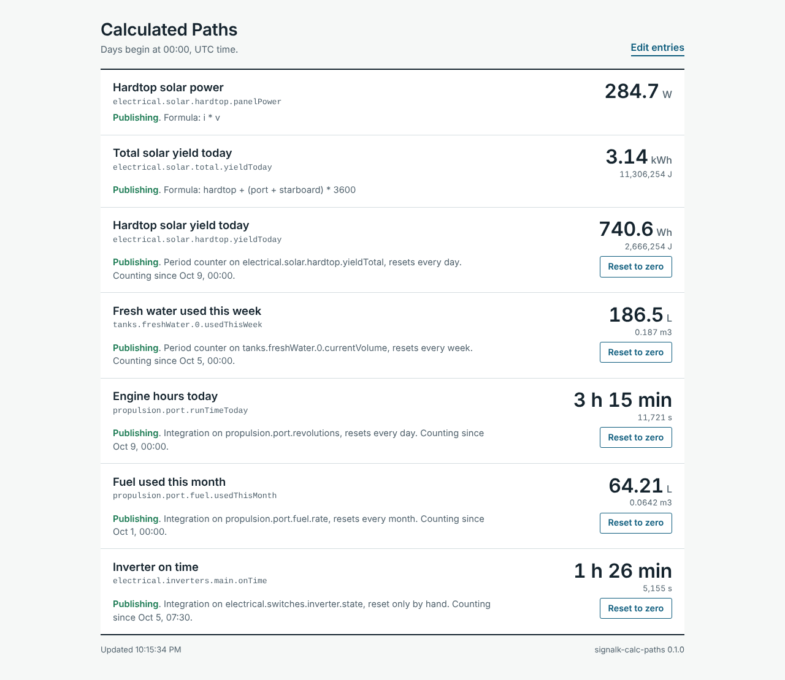
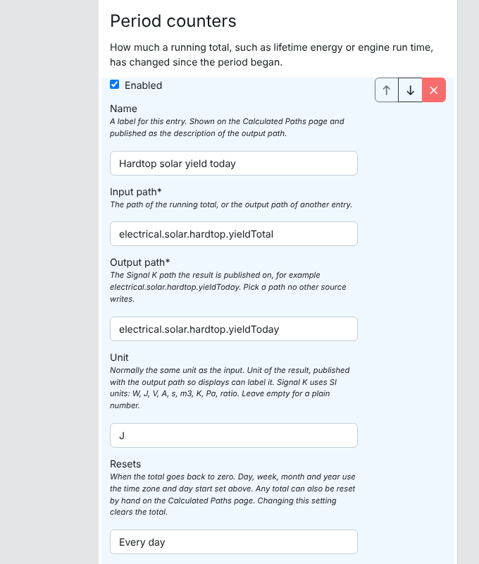
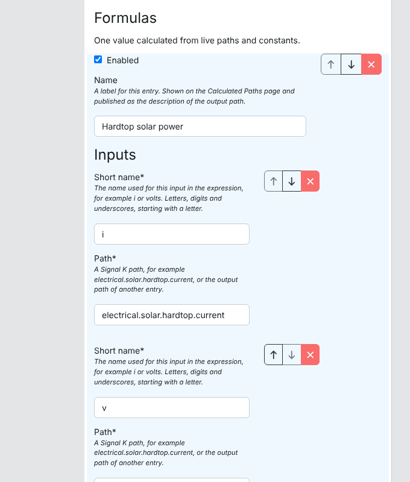

# Signal K Calculated Paths


This plugin calculates new Signal K paths from existing ones and publishes them like any other data. It offers three kinds of calculation: a formula over live values, a counter that reports how much a running total has changed since the start of a day, week, month or year, and an integration that adds up a rate over time. It targets the Signal K Node server and is meant for boats whose instruments report a raw figure (a current and a voltage, a lifetime energy total, an engine speed) where a derived figure is wanted (power, energy today, engine hours today).

## Project Status

New and actively maintained. Version 0.1.0 is the first public release: the calculations are covered by automated tests and were checked against recorded data from a boat, and the plugin has run inside Signal K server 2.33.0. Wider field use is still to come. See [CHANGELOG.md](CHANGELOG.md) for release history and [Issues](https://github.com/Peter-Petrik/signalk-calc-paths/issues) for planned work.

The plugin publishes calculated values into Signal K paths. It is not an automation tool and does not replace Node-RED: it switches nothing and raises no notifications.

## Features

- **Formulas**: An expression over any number of live paths and constants, for example `i * v` or `(a + b + c) / 3600`. Arithmetic, comparisons, conditions and common mathematical functions are available. Expressions are parsed by a library and never passed to JavaScript's `eval`.
- **Period Counters**: The change in a running total since the start of the day, week, month or year, or since a manual reset. Counting increases suits lifetime energy and engine run time; counting decreases turns a falling tank level into consumption.
- **Integrations**: A rate added up over time (power into energy, flow into volume), or the time an input spends above a threshold (engine running time, time a switch is on).
- **Selectable Resets**: Each total resets at a boundary in a configured time zone, with a configurable start of day, or in step with another path, so that a calculated daily total can follow a device that keeps its own day.
- **Chaining**: An entry can read the output of another entry. A formula can feed an integration, and a counter can feed a formula. Entries are calculated in dependency order, each once per incoming update.
- **Stale Input Handling**: Each entry stops publishing, or keeps publishing its last result, when an input goes quiet for longer than its stale timeout. The choice is per entry.
- **State Persistence**: Totals survive server restarts. The state file is rewritten in place and holds no history.
- **Unit Metadata**: Each output announces its unit and name, so instrument displays can label it.
- **Status Page**: A page under **Webapps** lists every entry with its current value, its state and a reset button.
- **Clock Safety**: Sums are measured on a monotonic clock, and period resets pause while the system clock is recognisably unset, so a computer that boots at 1970 does not reset its totals or count the correction as elapsed time.

## Configuration

Settings are entered under **Apps & Plugins > Configuration > Calculated Paths**. Entries are kept in three lists, one per calculation type.

### General Settings

| Setting | Default | Meaning |
| :--- | :--- | :--- |
| Time zone | server's zone | IANA time zone name, for example `Europe/Athens`, that decides when a day begins. Many boat computers run on UTC, in which case the server's zone is not local time. |
| Day starts at | `00:00` | Time of day, as `HH:MM`, at which a new day begins. Weeks, months and years begin at the same time of day. |
| Week starts on | Monday | Monday, Sunday or Saturday. |
| Repeat unchanged values every | 10 s | A result is published when it changes, at most once a second. An unchanged result is sent again at this interval. `0` publishes changes only. |

### Settings Shared by All Entries

| Setting | Default | Meaning |
| :--- | :--- | :--- |
| Enabled | on | A disabled entry publishes nothing and keeps its saved total. |
| Name | empty | Label shown on the status page and published as the output's description. |
| Output path | none | The Signal K path the result is published on. It needs at least two segments and must not be written by another source. |
| Unit | empty | Unit published with the output. Signal K uses SI units: `W`, `J`, `V`, `A`, `s`, `m3`, `K`, `Pa`, `ratio`. |
| Stale timeout | 60 s | An input with no new value for this long is stale. `0` means the input is sent only when it changes and never goes stale. |
| When an input is stale | Stop publishing | Stop publishing until the input returns, or keep publishing the last result. |

### Formulas

| Setting | Meaning |
| :--- | :--- |
| Inputs | A list of short names, each mapped to a path. A short name is made of letters, digits and underscores and starts with a letter. Paths cannot be written directly in an expression because they contain dots and dashes. |
| Expression | The calculation, written with the short names. |

Operators: `+`, `-`, `*`, `/`, `%`, `^`, the comparisons `==`, `!=`, `<`, `<=`, `>`, `>=`, the logical `and`, `or`, `not`, and the condition `test ? a : b`. A comparison used as the whole expression publishes `1` or `0`. The constants `PI` and `E` are available.

Functions: `abs`, `acos`, `acosh`, `asin`, `asinh`, `atan`, `atan2`, `atanh`, `cbrt`, `ceil`, `cos`, `cosh`, `exp`, `expm1`, `floor`, `hypot`, `if`, `lg`, `ln`, `log`, `log10`, `log1p`, `log2`, `max`, `min`, `pow`, `pyt`, `round`, `roundTo`, `sign`, `sin`, `sinh`, `sqrt`, `tan`, `tanh`, `trunc`.

Assignment, function definitions, arrays, string concatenation and property access are switched off. A result that is not a finite number, such as a division by zero, is not published.

### Period Counters

| Setting | Default | Meaning |
| :--- | :--- | :--- |
| Input path | none | The path of the running total. |
| Resets | Every day | Every day, week, month or year; when another path resets; or only by hand. |
| Path to follow for resets | empty | Used with "When another path resets". The total is cleared whenever the value on this path falls. |
| Count | Increases only | Increases only, decreases only, or net change (signed). |
| When the input moves the other way | Carry on | Carry on counting from the new value, or wait until the previous level is passed again. Applies to the two one-way settings. |
| Smallest change to count | 0 | Changes smaller than this, in the input's unit, are ignored until they add up to at least this much. |

### Integrations

| Setting | Default | Meaning |
| :--- | :--- | :--- |
| Input path | none | The path to add up. |
| Add up | The value multiplied by time | Value multiplied by time gives the input's unit times seconds (`W` becomes `J`, `m3/s` becomes `m3`). The alternative adds up the time the value is above the threshold, in seconds. |
| Threshold | 0 | Used when adding up time. Time counts while the input is greater than this. |
| Resets, Path to follow for resets | Every day | As for period counters. |
| When values stop for longer than the stale timeout | Leave the gap out | Leave the gap out of the total, or bridge it with the last value. |

## How the Calculations Behave

### Period Boundaries

1. The baseline of a period is the last input value seen before the boundary. At the boundary the output publishes `0`.
2. Change that arrives with the first value after a boundary belongs to the new period. With an input that reports every few seconds this moves at most a few seconds of change across the boundary.
3. Days follow the configured time zone, including its daylight saving changes: a day is 23 or 25 hours long on the two change dates. Where a clock change skips the day-start time itself, that day begins later by the length of the skipped stretch; where the day-start time occurs twice, the day begins the first time.
4. With "When another path resets", the boundary settings are not used. The total clears whenever the followed value falls. A fall that happened while the server was stopped is noticed at restart only if the followed value is still below the last one seen before the stop.

### Restarts

1. Totals, baselines and period starts are restored from the state file. Changing an entry's **Resets** setting clears its total, because a total collected under one rule means nothing under another; a period counter keeps its place in its input.
2. A period counter resumes from the last input value it saw. Whatever the source counted while the server was stopped is added when the first new value arrives. If a boundary passed in the meantime, that change lands in the current period and the status page says so.
3. An integration adds nothing for the time the server was stopped.
4. Values the server already holds when the plugin starts are used at once, each judged against the stale timeout by its real age. An integration counts from the start, not from the age of such a value.

### Counter Direction

1. With "Increases only", a fall in the input is not counted. By default counting carries on from the new, lower value, which is the right behaviour for a source counter that restarts from zero. The alternative waits until the input has passed its previous level, which ignores a brief dip in a total that should never go back.
2. With "Decreases only", a rise is not counted. This suits a tank: the level falling is consumption, and a refill is ignored.
3. "Net change" reports the signed difference since the period began.

### Integration Method

1. An input with a stale timeout above zero is treated as regularly sampled. Consecutive values are joined by a straight line (the trapezoid rule), and the total grows when each new value arrives.
2. An input with a stale timeout of `0` is treated as a value that holds until the next one arrives. The total grows every second in between. This suits a switch state or any input that is sent only when it changes.
3. A stretch between two values that is longer than the stale timeout is a gap. By default it is left out, so the total undercounts and never invents data. With "bridge" the input is assumed to have stayed at its last value for the whole gap.
4. A stretch that spans a period boundary is split at the boundary.

### Input Values

1. Numbers are used as they are. `true` and `false` count as `1` and `0`.
2. `null` means the source has no reading: a formula waits and publishes nothing, and an integration does not join the values on either side of it.
3. Text, objects such as a position, and numbers that are not finite are treated the same way as `null`.
4. Where several sources publish one path, the plugin receives the source the server's source priority prefers.
5. Values that a source sends in one Signal K update are applied together, so a formula over two of them is calculated once, from both.

### Stale Inputs

1. An entry whose input is older than its stale timeout is stale. A formula is stale when any one of its inputs is.
2. With "Stop publishing", a stale entry publishes nothing until the input returns.
3. With "Keep publishing the last result", a stale entry goes on sending its last result. A formula is not recalculated while one of its inputs is stale, even if the others keep changing.
4. To the entries that read it, an entry that has stopped publishing, or a formula with no result, counts as having no value. An integration fed by such an entry stops adding and does not join the values on either side of the hole.

### System Clock

1. Durations are measured on a monotonic clock, so a jump of the system clock neither adds nor removes counted time.
2. Period boundaries need the real date. While the system clock reads earlier than 2024 or earlier than the last saved state, period resets are paused and totals keep counting. Resets resume when the clock is correct.
3. If the clock stays behind the saved state for an hour, the clock is believed and the saved time is discarded.
4. A clock that is wrong but plausible cannot be detected. A computer that restores its last shutdown time at boot runs on a date that is not earlier than the saved state, so it is trusted; if the correction later crosses a period boundary, the total resets at that moment.

## Examples

The paths below are examples; the actual paths depend on the installation.

### Power From Current and Voltage

A formula with inputs `i` = `electrical.solar.hardtop.current` and `v` = `electrical.solar.hardtop.voltage`, expression `i * v`, output `electrical.solar.hardtop.panelPower`, unit `W`.

### Energy Today From a Lifetime Total

A period counter on `electrical.solar.hardtop.yieldTotal`, output `electrical.solar.hardtop.yieldToday`, unit `J`, reset every day.

### A Daily Total That Follows Another Device

Some charge controllers publish their own daily yield and reset it at their own time, not at midnight. To make a calculated daily total reset at the same moment, set **Resets** to "When another path resets" and **Path to follow for resets** to that device's daily yield, for example `electrical.solar.port.yieldToday`.

### A Total Across Devices With Different Units

Not every source publishes SI units. A formula can convert while adding. With a calculated total in joules and two devices that report watt-hours: inputs `hardtop`, `port` and `starboard`, expression `hardtop + (port + starboard) * 3600`, unit `J`.

### Engine Hours Today

Two methods are available, and the right one depends on the engine.

| Method | Entry | Suits |
| :--- | :--- | :--- |
| Counter | A period counter on `propulsion.port.runTime`, unit `s`. | An engine computer that reports run time in fine steps. |
| Running time | An integration on `propulsion.port.revolutions`, adding up the time above a threshold of `0`, unit `s`. | An engine computer that reports run time in whole hours. |

The difference matters. On a boat whose engine computer counts whole hours, a run recorded at 3.25 hours by engine speed appeared as 4 hours on the run time counter, because four hour marks happened to fall inside the run. The running-time method depends on the engine speed being published while the engine runs and reading `0`, or nothing, when it is stopped.

### Fuel Used

An integration on `propulsion.port.fuel.rate` (in `m3/s`), adding up the value multiplied by time, unit `m3`. The result is as good as the rate: where the rate is an estimate derived from engine speed, the total is an estimate too.

### Water Used From a Tank Level

A period counter on `tanks.freshWater.0.currentVolume`, counting decreases only, unit `m3`. A smallest change of a few litres (`0.002` is two litres) keeps the ripple of the level sensor out of the total.

### Time a Switch Is On

An integration on a switch state such as `electrical.switches.inverter.state`, adding up the time above a threshold of `0`, with a stale timeout of `0`, unit `s`.

## Limitations and Assumptions

1. An integration adds nothing while the server or the plugin is stopped. A period counter does not have this limit, because the source keeps the total.
2. After a crash or power cut, up to 30 seconds of an integration's total can be lost: changed totals are written to disk every 30 seconds, on a clean stop and at every reset. While any total is changing, the state file is therefore rewritten every 30 seconds.
3. The first value an entry ever sees only sets its starting point. The first period after an entry is created is therefore partial; the status page shows when counting began.
4. A period counter in a one-way mode counts every change of at least the smallest change. Sensor noise larger than that setting is counted as real change.
5. The time zone is a setting. It does not follow the boat's position.
6. Period resets depend on the system clock being correct. An unset clock is detected; a wrong but plausible one is not. See [System Clock](#system-clock).
7. Units are neither checked nor converted. The unit entered is published as given, and a formula that mixes units must convert them itself.
8. Only numbers and true/false values can be read. A field inside an object value cannot be selected.
9. The plugin does not check whether another source already writes an output path. Two writers on one path give alternating values.
10. A formula is evaluated on every input value and published at most once a second. It does not average or smooth.
11. "When another path resets" treats any fall of the followed value as a reset.
12. Published numbers are rounded to twelve significant digits.
13. Node.js 22 or later is required.

## Prerequisites

- **Signal K Server**: Developed and tested on Signal K server 2.33.0.
- **Node.js**: Version 22 or later.
- **Input Paths**: The paths to calculate from must already be present in Signal K. **Data > Browser** shows them with their units.

## Quick Start Guide

1. Open the Signal K admin UI, navigate to **Apps & Plugins > Store** and install `signalk-calc-paths`.
2. Restart the server when prompted.
3. Go to **Apps & Plugins > Configuration > Calculated Paths**.
4. Set the **Time zone** if the server does not run on local time.
5. Add an entry to **Formulas**, **Period counters** or **Integrations**, fill in its paths and unit, and enable the plugin.
6. Click **Submit**.
7. Open **Webapps > Calculated Paths** to see each entry's value and state.
8. Check the new path under **Data > Browser**.

## Technical Details

### Status Page and Access

The status page is at `/signalk-calc-paths/`. With server security enabled, any logged-in user can view it, and resetting a total requires read/write or admin access. On servers that predate per-route access levels, both actions require admin access.

The page shows each value in an everyday unit (Wh or kWh for joules, hours and minutes for seconds, litres for small volumes) with the published SI value beneath it.

### HTTP Interface

| Request | Access | Result |
| :--- | :--- | :--- |
| `GET /plugins/signalk-calc-paths/api/entries` | Any logged-in user | Every entry with its value, state and message. |
| `POST /plugins/signalk-calc-paths/api/entries/{output path}/reset` | Read/write or admin | Clears the total of one counter or integration. |

The interface is described in the server's OpenAPI browser, opened from **OpenApi** in the admin menu.

### State File

Totals are kept in one file in the plugin's data directory:

```
~/.signalk/plugin-config-data/signalk-calc-paths/state.json
```

The file is rewritten in place and holds one small record per counter and integration. It keeps no history and does not grow. Removing an entry from the configuration removes its record at the next save; disabling an entry keeps it. An entry's record is discarded when its output path, its input path, its direction, its integration mode or, when adding up time, its threshold is changed, because the old total no longer describes the new calculation.

To clear every total, stop the plugin, delete the file and start the plugin. A file that cannot be read is moved aside as `state.json.unreadable-<number>` and reported in the plugin status.

### History and Databases

The plugin keeps no history. Its outputs are ordinary Signal K paths, so a history plugin such as `signalk-to-influxdb2` stores them like any other path, unless a filter there excludes them.

### Validation

The calculations were replayed over five days of recorded data from one boat and compared with figures computed independently:

1. Daily energy from a lifetime counter matched to 0.1 Wh on each of the five days.
2. Energy from integrating current times voltage matched the lifetime counter within 0.1 % on both days checked.
3. Engine running time and fuel used matched an independent calculation over a run of 3.25 hours.

The recorded data is not part of this repository. The automated tests use synthetic data.

### Log Monitoring

To stream log lines from this plugin:

```bash
journalctl -u signalk -f | grep "signalk-calc-paths"
```

Detailed messages appear after switching on **Enable debug log** on the plugin's configuration page.

### Troubleshooting

**An entry stays at "Waiting".** No value has arrived on one of its inputs. The status page names the path. Check its spelling against **Data > Browser**.

**An entry shows "Stale".** The input stopped updating for longer than the stale timeout. For an input that is sent only when it changes, set the stale timeout to `0`.

**A daily total resets at the wrong time.** The time zone is empty and the server runs on UTC. Set the **Time zone**.

**The status reports a configuration error.** One entry cannot run: a path is missing or malformed, an expression does not parse, two entries write the same path, or entries feed each other in a loop. The other entries keep running. The message names the entry.

**A total is higher than expected on a tank or level.** Sensor ripple is being counted. Raise **Smallest change to count**.

## Future Enhancements

These are not implemented.

* **Previous-Period Values**: Publishing the finished total of the last period, such as yesterday's yield, on a second path.
* **Fields Inside Object Values**: Reading one field of an object-valued path.
* **Time Zone From Position**: Following a time zone published in Signal K instead of a fixed setting.
* **Reset by Signal K PUT**: Resetting a total from another plugin or a phone shortcut.
* **Averages and Extremes**: A fourth entry type for the mean, minimum or maximum over a period.

## Support

For bug reports and feature requests, open an issue at [GitHub Issues](https://github.com/Peter-Petrik/signalk-calc-paths/issues). Include the Signal K server version, the Node.js version, the plugin version, the configuration of the entry concerned and relevant log output.

Contributions are welcome. See [CONTRIBUTING.md](CONTRIBUTING.md) for guidelines.

## Screenshots

### Status Page


### Plugin Configuration



## License

Copyright 2026 Peter Petrik. Licensed under the [GNU General Public License v3.0 or later](LICENSE).
